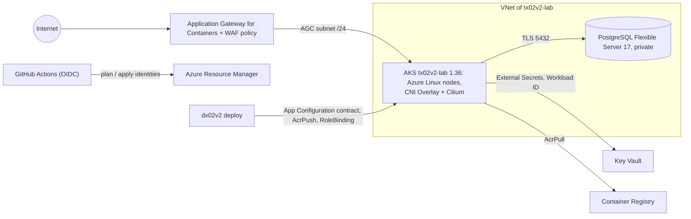

# tx02v2

Azure infrastructure half of a DevOps lab: Terraform, AKS, PostgreSQL Flexible Server, Application Gateway for Containers + WAF and GitHub Actions with OIDC.

[](https://github.com/maringelix/tx02v2/actions/workflows/ci.yml)

[Português](README.pt-BR.md)

## What is this

A public, educational lab you can clone or fork to learn how a small AKS platform is built, tested
and torn down safely. Everything is checked by a local harness that needs no cloud account; the
cloud path is optional and costs money. **v2 has never been applied to Azure** — the status matrix
below says exactly what is proven and how.

The lab family (v2):

| Repository | Cloud | Role | Status |
|---|---|---|---|
| [`tx01v2`](https://github.com/maringelix/tx01v2) | AWS | infrastructure (Terraform, EKS, RDS, platform layer) | see its status matrix |
| [`dx01v2`](https://github.com/maringelix/dx01v2) | AWS | application | see its status matrix |
| `tx02v2` (this repo) | Azure | infrastructure (Terraform, platform layer) | see status matrix |
| [`dx02v2`](https://github.com/maringelix/dx02v2) | Azure | application (sibling of this repo, built against `docs/CONTRATO.md`) | see its status matrix |
| [`tx03v2`](https://github.com/maringelix/tx03v2) | GCP | infrastructure (Terraform, GKE Autopilot, Cloud SQL, Cloud Armor) | see its status matrix |
| [`dx03v2`](https://github.com/maringelix/dx03v2) | GCP | application (the dx01v2 app on GKE Autopilot) | see its status matrix |

## Status matrix

| Capability | Status | Evidence |
|---|---|---|
| Formatting, validation, provider lock files (4 platforms) | `verified in CI` | `make static` (`terraform-fmt`, `terraform-validate:*`, `terraform-lockfiles`); CI job `static` |
| Lint and IaC security scan (tflint + azurerm ruleset, trivy HIGH/CRITICAL, plain and with the example inputs) | `verified in CI` | `make static` (`tflint`, `trivy-config`, `trivy-config-tfvars`) |
| Workflows, scripts, platform manifests and Helm values (actionlint, shellcheck, kubeconform, helm template with the chart SHA256) | `verified in CI` | `make static` (`actionlint`, `shellcheck`, `kubeconform`, `helm-template`) |
| Secret scan and repository policies (no real identifiers or GUIDs, pinned actions, contract tags on every taggable resource, v1 regressions) | `verified in CI` | `make static` (`gitleaks`, `policy-*`, `repo-structure`, `version-consistency`) |
| Contract v1 with dx02v2 (15 App Configuration keys, namespace, deployer RBAC, ClusterSecretStore) | `verified in CI` | `make static` (`contract-appconfig`, `contract-platform`); [docs/CONTRATO.md](docs/CONTRATO.md) |
| Terraform unit tests with a mocked azurerm provider (OIDC subjects, state account, ABAC role list = lab roles, budget, AKS, PostgreSQL, Key Vault, ACR, AGC + WAF, contract keys, role assignments, negative validations; 71 runs) | `verified in CI` | `make test`; CI job `test` |
| Bootstrap (resource providers, state account, lab resource group, GitHub OIDC identities, budget) | `not run in the cloud (v2)` | `terraform/bootstrap`, `docs/RUNBOOK.md` |
| Lab apply (VNet, AKS 1.36, PostgreSQL 17, Key Vault, ACR, AGC + WAF, App Configuration contract) | `not run in the cloud (v2)` | `.github/workflows/terraform-apply.yml` |
| Plan on pull requests | `not run in the cloud (v2)` | `.github/workflows/terraform-plan.yml` |
| Platform layer (ALB Controller 1.12.2, External Secrets Operator 2.12.0) | `not run in the cloud (v2)` | `.github/workflows/platform.yml`, `platform/install.sh` |
| Destroy + leftover check | `not run in the cloud (v2)` | `.github/workflows/terraform-destroy.yml`, `scripts/leftovers.sh` |
| HTTPS on the Application Gateway for Containers listener | `planned` | outside contract v1 (`docs/CONTRATO.md`) |
| Repository settings as code (ruleset, environment `lab`) | `planned` | `scripts/repo-guardrails.sh`, `docs/PUBLICACAO.md` |
| **Local lab, static checks**: `terraform/envs/local` plan tests (private network, labels, loopback-only registry, TLS-only database, digests, negative validations; 10 runs), 15 local charts by SHA256 rendering digests and ClusterIP only, Gatekeeper policies against their gator cases | `verified locally` | `terraform-test:envs/local`, `helm-template-local`, `kubeconform-local`, `policy-gator`, `local-versions` |
| **Local lab** (Terraform on Docker): kind cluster + emulated ACR, PostgreSQL (TLS only), Blob Storage (S3 API emulator), load balancer, git server; destroy + leftover check | `verified in CI` | `make e2e` (`terraform/envs/local`, `scripts/local-lab.sh`) |
| Service mesh: Istio 1.31 ambient, mTLS `STRICT`, identity-based `AuthorizationPolicy` | `verified in CI` | `make e2e` (`platform/local/check.sh`: allowed, other identity and plaintext probes) |
| Gateway API on Istio behind the emulated load balancer, HTTPS with cert-manager (lab CA), HTTP → HTTPS | `verified in CI` | `make e2e` |
| External Secrets (ClusterSecretStore `local-secrets`), metrics-server | `verified in CI` | `make e2e` |
| Observability: Prometheus, Alertmanager (synthetic alert delivered), Grafana (ClusterIP), Loki + Alloy | `verified in CI` | `make e2e` |
| GitOps with Argo CD 3.5 (commit → sync → self-heal from the lab git server) | `verified in CI` | `make e2e` |
| Policy as code in the cluster: Gatekeeper 3.23 in `deny` (allowed registries, pinned images, resources, probes, labels, NodePort) | `verified in CI` | `make e2e` |
| In-cluster scanning: Trivy Operator (vulnerability and configuration reports) | `verified in CI` | `make e2e` |
| Backup and restore drill: Velero to the object storage emulator (namespace deleted, restored with its data) | `verified in CI` | `make e2e` |
| Chaos engineering with a hypothesis: Chaos Mesh pod-kill, availability measured | `verified in CI` | `make e2e` |
| The same add-ons on AKS | `planned` | the local platform shows the target; the cloud platform layer installs only the ALB Controller + ESO |

`verified in CI` rows (`HARNESS_STRICT=1 make verify`) run on every pull request, on every
push to `main` and weekly (CI jobs `static` and `test`). A cloud row changes only with a
`cloud_run_report` issue (date, location, commits, cost, leftovers). The local lab rows will also run
in the CI job `e2e`.

## Architecture



- `terraform/bootstrap`: resource provider registrations, the state storage account (Entra ID only,
  blob lease locking), the `tx02v2-lab` resource group, the three GitHub OIDC identities with their
  roles (the apply identity can assign only the lab roles, through an ABAC condition) and the monthly
  budget. Applied once, locally, by the subscription Owner.
- `terraform/envs/lab`: modules `network`, `aks`, `postgres`, `keyvault`, `acr`, `agc`, `appconfig`,
  the generated secrets (ephemeral, write-only) and the App Configuration keys dx02v2 reads.
- `platform/`: Helm charts and manifests installed after the apply, never by Terraform.
- Design decisions, the AWS ↔ Azure table and the v1 → v2 table: [docs/ARQUITETURA.md](docs/ARQUITETURA.md).

## Quick start (free, local)

You need Docker (devcontainer) or Linux/WSL 2 with bash >= 4.4, curl, unzip, xz, git and make.

```bash
git clone https://github.com/maringelix/tx02v2.git && cd tx02v2
make tools                     # pinned tools into .tools/, SHA256-verified
HARNESS_STRICT=1 make verify   # every static check + terraform test
make help
```

On Windows or macOS, open the folder in the devcontainer (`.devcontainer/devcontainer.json`); it
runs `make tools` for you. Nothing here touches Azure.

### The whole lab on your machine (free)

The v1 lab ran its platform (mesh, monitoring, GitOps, policies, scanning, backup, chaos) only in
the cloud. The local lab builds the same platform on Docker, so you can study and break it without
an account (status above: the end-to-end round is `verified in CI`):

```bash
make e2e            # up + every probe + down: about 30-40 minutes on tx01v2, 8 GB of Docker memory for "full"
make local-up       # or keep it running (LOCAL_PROFILE=core|observability|operations|full)
make local-check    # probes against the running lab
make local-down     # destroy + leftover check
```

| Azure (cloud path) | Local lab |
|---|---|
| AKS 1.36 | kind 1.36 (`terraform/envs/local`) |
| Azure Container Registry | registry (`registry.tx02v2.local`, push to `localhost:5002`) |
| PostgreSQL Flexible Server 17, TLS `verify-full` | PostgreSQL 17, TLS only, lab CA |
| Application Gateway for Containers + ALB Controller (WAF policy) | cloud-provider-kind + Istio Gateway (Gateway API); no WAF |
| HTTPS listener certificate (`planned` on AGC) | cert-manager, ClusterIssuer `lab-ca` |
| Key Vault + ESO (Workload ID) | Secrets of `lab-secrets` + ESO |
| Blob Storage (backups) | Versity S3 Gateway (S3 API) |
| App Configuration contract | ConfigMap `lab-system/lab-contract` (`docs/CONTRATO.md`) |
| GitHub (GitOps source) | Soft Serve git server |

Details, probes and limits: [docs/LAB_LOCAL.md](docs/LAB_LOCAL.md) and
[docs/ARQUITETURA.md](docs/ARQUITETURA.md). Deploying dx02v2 on top of it (through the local contract)
is `planned` in dx02v2.

## Cloud path (costs money)

**Cost first:** about US$0.51 per hour in eastus2 with the defaults, US$0.39 without the WAF.
Application Gateway for Containers with the WAF is the biggest item (US$0.279 per hour, about 54 %).
A forgotten lab costs about US$12 per day, about US$374 per month. Reference list prices (Azure
Retail Prices API, 2026-10-11): see [docs/CUSTOS.md](docs/CUSTOS.md) and the official calculator.
Use a dedicated subscription, keep the budget alerts and destroy on the same day. On a Free Trial
subscription, v1 found PostgreSQL Flexible Server blocked by offer restrictions
([docs/RUNBOOK.md](docs/RUNBOOK.md), section 1).

Follow [docs/RUNBOOK.md](docs/RUNBOOK.md): bootstrap → GitHub variables of tx02v2 and dx02v2 →
apply → platform → deploy dx02v2 → smoke test → destroy → leftover check (locally, as the
subscription Owner) → `cloud_run_report` issue.

## Harness

| Target | What it runs | When |
|---|---|---|
| `make help` | lists the targets | any time |
| `make tools` | `scripts/install-tools.sh`: terraform 1.16.5, tflint 0.64.0 + azurerm ruleset 0.32.0, trivy 0.75.0, actionlint 1.7.12, shellcheck 0.11.0, kubeconform 0.8.0, gitleaks 8.30.1, kubectl 1.37.1, helm 4.3.0, kubelogin 0.2.21, kind 0.33.0, gator 3.23.1 | once, and after a tool bump |
| `make static` | `scripts/harness.sh static` | before every push |
| `make test` | `scripts/harness.sh test` (`terraform test`, mocked providers) | before every push |
| `make verify` | static + test (CI jobs `static` and `test`) | before every PR |
| `make e2e` | `scripts/harness.sh e2e`: the local lab end to end (CI job `e2e`) | platform or local lab changes |
| `make all` | static + test + e2e | — |
| `make clean` | removes `.tools/`, caches and Terraform working dirs | — |

`scripts/harness.sh list` prints every check. Details: [docs/HARNESS.md](docs/HARNESS.md).

## Docs

All docs are in Brazilian Portuguese.

| Doc | Content |
|---|---|
| [docs/ARQUITETURA.md](docs/ARQUITETURA.md) | diagram, ADRs, AWS ↔ Azure, v1 → v2 |
| [docs/CONTRATO.md](docs/CONTRATO.md) | tx02v2 ⇄ dx02v2 contract v1 (source of truth) |
| [docs/RUNBOOK.md](docs/RUNBOOK.md) | full cloud round |
| [docs/LAB_LOCAL.md](docs/LAB_LOCAL.md) | the local lab: what is emulated, how to run it, probes, limits |
| [docs/CUSTOS.md](docs/CUSTOS.md) | cost estimate per component, with and without the WAF |
| [docs/GUARDRAILS.md](docs/GUARDRAILS.md) | rules, enforcement, exceptions, limits |
| [docs/HARNESS.md](docs/HARNESS.md) | checks, strict mode, troubleshooting |
| [docs/SUSTENTACAO.md](docs/SUSTENTACAO.md) | routines, end-of-support calendar, update procedures |
| [docs/PUBLICACAO.md](docs/PUBLICACAO.md) | checklist to make the repository public |
| [docs/LICOES_APRENDIDAS.md](docs/LICOES_APRENDIDAS.md) | lessons learned from the Azure v1 lab |

## Contributing

Read [CONTRIBUTING.md](CONTRIBUTING.md) and [AGENTS.md](AGENTS.md) (also for humans). Security
issues: [SECURITY.md](SECURITY.md).

## License

[MIT](LICENSE) — Copyright (c) 2025-2026 Bruno Maringeli.
