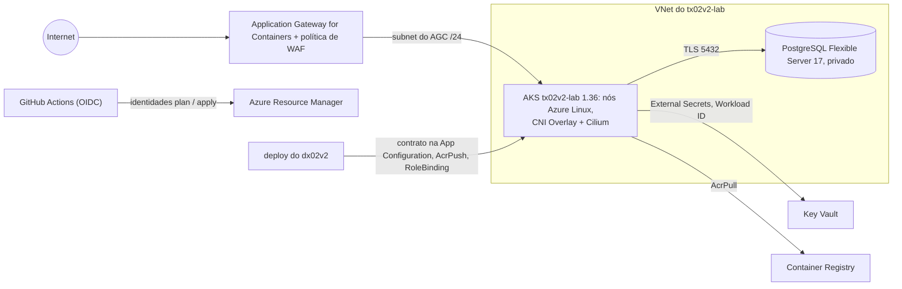

# tx02v2

Metade de infraestrutura Azure de um lab de DevOps: Terraform, AKS, PostgreSQL Flexible Server, Application Gateway for Containers + WAF e GitHub Actions com OIDC.

[](https://github.com/maringelix/tx02v2/actions/workflows/ci.yml)

[English](README.md)

## O que é

Um lab público e educacional para clonar ou fazer fork e aprender como uma plataforma AKS pequena é
construída, testada e destruída com segurança. Tudo é verificado por um harness local que não precisa
de conta na nuvem; o caminho em nuvem é opcional e custa dinheiro. **A v2 nunca foi aplicada na
Azure** — a matriz de status abaixo diz exatamente o que está provado e como.

A família do lab (v2):

| Repositório | Nuvem | Papel | Status |
|---|---|---|---|
| [`tx01v2`](https://github.com/maringelix/tx01v2) | AWS | infraestrutura (Terraform, EKS, RDS, camada de plataforma) | veja a matriz de status dele |
| [`dx01v2`](https://github.com/maringelix/dx01v2) | AWS | aplicação | veja a matriz de status dele |
| `tx02v2` (este repositório) | Azure | infraestrutura (Terraform, camada de plataforma) | ver matriz de status |
| [`dx02v2`](https://github.com/maringelix/dx02v2) | Azure | aplicação (par deste repositório, construída sobre o `docs/CONTRATO.md`) | veja a matriz de status dele |
| `tx03v2` / `dx03v2` | GCP | infraestrutura / aplicação | `planejado` |

## Matriz de status

| Capacidade | Status | Evidência |
|---|---|---|
| Formatação, validação, lock files de providers (4 plataformas) | `verificado no CI` | `make static` (`terraform-fmt`, `terraform-validate:*`, `terraform-lockfiles`); job `static` do CI |
| Lint e scan de segurança da IaC (tflint + ruleset azurerm, trivy HIGH/CRITICAL, simples e com as entradas de exemplo) | `verificado no CI` | `make static` (`tflint`, `trivy-config`, `trivy-config-tfvars`) |
| Workflows, scripts, manifests da plataforma e values do Helm (actionlint, shellcheck, kubeconform, helm template com o SHA256 do chart) | `verificado no CI` | `make static` (`actionlint`, `shellcheck`, `kubeconform`, `helm-template`) |
| Scan de segredos e políticas do repositório (sem identificadores reais nem GUIDs, actions fixadas, tags do contrato em todo recurso que aceita tags, regressões do v1) | `verificado no CI` | `make static` (`gitleaks`, `policy-*`, `repo-structure`, `version-consistency`) |
| Contrato v1 com o dx02v2 (15 chaves da App Configuration, namespace, RBAC do deployer, ClusterSecretStore) | `verificado no CI` | `make static` (`contract-appconfig`, `contract-platform`); [docs/CONTRATO.md](docs/CONTRATO.md) |
| Testes unitários do Terraform com provider azurerm mockado (sujeitos OIDC, conta do state, lista ABAC = papéis do lab, budget, AKS, PostgreSQL, Key Vault, ACR, AGC + WAF, chaves do contrato, atribuições de papel, validações negativas; 71 casos) | `verificado no CI` | `make test`; job `test` do CI |
| Bootstrap (resource providers, conta do state, grupo do lab, identidades OIDC do GitHub, budget) | `não executado em nuvem (v2)` | `terraform/bootstrap`, `docs/RUNBOOK.md` |
| Apply do lab (VNet, AKS 1.36, PostgreSQL 17, Key Vault, ACR, AGC + WAF, contrato na App Configuration) | `não executado em nuvem (v2)` | `.github/workflows/terraform-apply.yml` |
| Plan em pull requests | `não executado em nuvem (v2)` | `.github/workflows/terraform-plan.yml` |
| Camada de plataforma (ALB Controller 1.12.2, External Secrets Operator 2.12.0) | `não executado em nuvem (v2)` | `.github/workflows/platform.yml`, `platform/install.sh` |
| Destroy + checagem de sobras | `não executado em nuvem (v2)` | `.github/workflows/terraform-destroy.yml`, `scripts/leftovers.sh` |
| HTTPS no listener do Application Gateway for Containers | `planejado` | fora do contrato v1 (`docs/CONTRATO.md`) |
| Configurações do repositório como código (ruleset, environment `lab`) | `planejado` | `scripts/repo-guardrails.sh`, `docs/PUBLICACAO.md` |

As linhas `verificado no CI` (`HARNESS_STRICT=1 make verify`, 32 checks) rodam em todo pull request,
em todo push para a `main` e toda semana (jobs `static` e `test` do CI). Uma linha de nuvem só muda
com uma issue `cloud_run_report` (data, região, commits, custo, sobras).

## Arquitetura



- `terraform/bootstrap`: registro dos resource providers, a conta de storage do state (só Entra ID,
  lock por lease de blob), o grupo `tx02v2-lab`, as três identidades OIDC do GitHub com seus papéis (o
  apply só consegue atribuir os papéis do lab, por uma condição ABAC) e o budget mensal. Aplicado uma
  vez, localmente, pelo Owner da assinatura.
- `terraform/envs/lab`: módulos `network`, `aks`, `postgres`, `keyvault`, `acr`, `agc`, `appconfig`,
  os segredos gerados (ephemeral, write-only) e as chaves da App Configuration que o dx02v2 lê.
- `platform/`: charts Helm e manifests instalados depois do apply, nunca pelo Terraform.
- Decisões de design, a tabela AWS ↔ Azure e a tabela v1 → v2: [docs/ARQUITETURA.md](docs/ARQUITETURA.md).

## Início rápido (grátis, local)

Você precisa de Docker (devcontainer) ou Linux/WSL 2 com bash >= 4.4, curl, unzip, xz, git e make.

```bash
git clone https://github.com/maringelix/tx02v2.git && cd tx02v2
make tools                     # ferramentas fixadas em .tools/, SHA256 conferido
HARNESS_STRICT=1 make verify   # todos os checks estáticos + terraform test
make help
```

No Windows ou macOS, abra a pasta no devcontainer (`.devcontainer/devcontainer.json`); ele roda
`make tools` sozinho. Nada aqui toca a Azure.

## Caminho em nuvem (custa dinheiro)

**Custo primeiro:** cerca de US$0,51 por hora em eastus2 com os padrões, US$0,39 sem o WAF. O
Application Gateway for Containers com WAF é o maior item (US$0,279 por hora, cerca de 54 %). Um lab
esquecido custa cerca de US$12 por dia, cerca de US$374 por mês. Preços de referência (Azure Retail
Prices API, 2026-10-11): veja o [docs/CUSTOS.md](docs/CUSTOS.md) e a calculadora oficial. Use uma
assinatura dedicada, mantenha os alertas do budget e destrua no mesmo dia. Numa assinatura Free
Trial, o v1 encontrou o PostgreSQL Flexible Server bloqueado por restrição da oferta
([docs/RUNBOOK.md](docs/RUNBOOK.md), seção 1).

Siga o [docs/RUNBOOK.md](docs/RUNBOOK.md): bootstrap → variáveis do GitHub do tx02v2 e do dx02v2 →
apply → plataforma → deploy do dx02v2 → smoke test → destroy → checagem de sobras (local, como Owner
da assinatura) → issue `cloud_run_report`.

## Harness

| Alvo | O que roda | Quando |
|---|---|---|
| `make help` | lista os alvos | a qualquer momento |
| `make tools` | `scripts/install-tools.sh`: terraform 1.16.5, tflint 0.64.0 + ruleset azurerm 0.32.0, trivy 0.75.0, actionlint 1.7.12, shellcheck 0.11.0, kubeconform 0.8.0, gitleaks 8.30.1, kubectl 1.37.1, helm 4.3.0, kubelogin 0.2.21 | uma vez, e depois de atualizar uma ferramenta |
| `make static` | `scripts/harness.sh static` | antes de cada push |
| `make test` | `scripts/harness.sh test` (`terraform test`, provider azurerm mockado) | antes de cada push |
| `make verify` | static + test (o que o CI roda) | antes de cada PR |
| `make all` | todos os estágios (aqui, igual ao verify) | — |
| `make clean` | remove `.tools/`, caches e diretórios de trabalho do Terraform | — |

`scripts/harness.sh list` mostra todos os checks. Detalhes: [docs/HARNESS.md](docs/HARNESS.md).

## Documentação

| Documento | Conteúdo |
|---|---|
| [docs/ARQUITETURA.md](docs/ARQUITETURA.md) | diagrama, ADRs, AWS ↔ Azure, v1 → v2 |
| [docs/CONTRATO.md](docs/CONTRATO.md) | contrato tx02v2 ⇄ dx02v2 v1 (fonte da verdade) |
| [docs/RUNBOOK.md](docs/RUNBOOK.md) | rodada completa na nuvem |
| [docs/CUSTOS.md](docs/CUSTOS.md) | estimativa de custo por componente, com e sem WAF |
| [docs/GUARDRAILS.md](docs/GUARDRAILS.md) | regras, aplicação, exceções, limites |
| [docs/HARNESS.md](docs/HARNESS.md) | checks, modo estrito, problemas comuns |
| [docs/SUSTENTACAO.md](docs/SUSTENTACAO.md) | rotinas, calendário de fim de suporte, procedimentos de atualização |
| [docs/PUBLICACAO.md](docs/PUBLICACAO.md) | checklist para tornar o repositório público |
| [docs/LICOES_APRENDIDAS.md](docs/LICOES_APRENDIDAS.md) | lições aprendidas com o lab Azure v1 |

## Contribuindo

Leia o [CONTRIBUTING.md](CONTRIBUTING.md) e o [AGENTS.md](AGENTS.md) (também para humanos).
Vulnerabilidades: [SECURITY.md](SECURITY.md).

## Licença

[MIT](LICENSE) — Copyright (c) 2025-2026 Bruno Maringeli.
