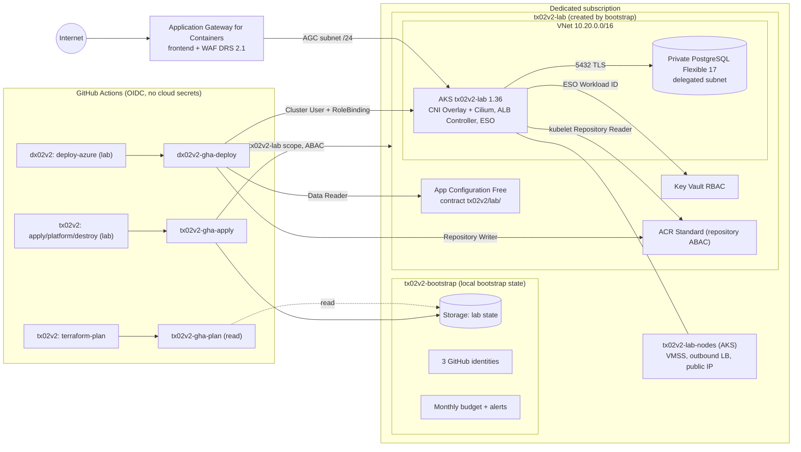
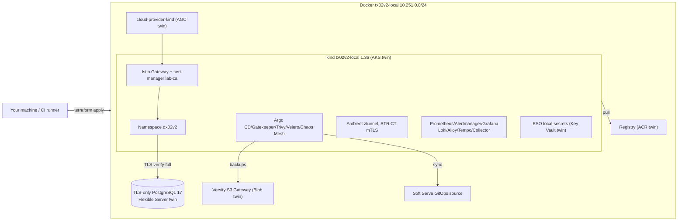

# tx02v2 architecture

> Decision tables and lessons preserve each round's initial state. Current
> HA/backup/PITR/DR scope is in [CONTINUITY.md](CONTINUITY.md); capacity,
> OpenCost/VPA/Spot and estimates are in [FINOPS.md](FINOPS.md). Earlier
> exclusions do not revoke later R7–R10 implementations.

Azure infrastructure overview, short architectural decisions, AWS equivalence
(tx01v2), and changes since v1. Nothing in v2 has been applied in Azure
(`not run in the cloud (v2)`); decisions have the tests/checks cited below.

## Diagram



Layers: terraform/bootstrap (once, by a human subscription Owner) →
terraform/envs/lab (network, aks, postgres, keyvault, acr, agc, appconfig,
velero, role-ids modules) → platform/ (Helm/manifests, never Terraform) →
dx02v2 application. Interface: CONTRACT.md.

## Full cloud profile (R4)

Terraform stays separate from Kubernetes platform installation. The lab root
provisions a Blob Storage Account, backup container, Velero identity/federation.
Helm installs 16 charts and Azure values. Workflow profile=core remains default;
full adds ambient/waypoint, observability/application SLOs, GitOps, Gatekeeper,
scanning, signed-image admission, backup and Chaos Mesh.

Argo CD is private ClusterIP. The app-of-apps reads platform/gitops from this
repository's main; its chart registers dx02v2 from the public gitops/azure branch.
Deployer can get/watch/patch only Application dx02v2, without listing/changing
other Applications. Before removing routes/Gateways, uninstall stops Applications
so reconciliation cannot recreate them.

Velero uses the Azure plugin, Entra Workload ID and a private Blob container,
with 35-day backup expiration. Data role is container-scoped. The account has
a public endpoint and no Private Endpoint; its firewall defaults to Deny and
allows only its own AKS node subnets (both regions for DR) using
Microsoft.Storage.Global. Overlay Pods SNAT to node IPs. Data still requires
Entra ID; shared keys are disabled. R9 covers objects and volume data through
FSB/Kopia rather than disk snapshots. PostgreSQL uses native backup. Lifecycle
expires only the backup prefix; shared chunks follow repository GC. Trivy and
Kyverno have Workload ID Repository Reader access only to both app repositories,
without saved registry passwords. Network/RBAC evidence is code and mocked
tests, not an Azure run.

Real chart renders, contracts and teardown were checked locally. Azure install,
backup and restore remain not run in the cloud (v2).

## Local lab

Docker emulates the same architecture (terraform/envs/local + platform/local)
with the complete v1 platform. This is tx01v2's local lab with tx02v2 names and
Azure twins. Details/probes/limits: LOCAL_LAB.md; CI e2e runs the complete flow.



## Decisions (short ADRs)

| # | Decision | Reason | Rejected alternative |
|---|---|---|---|
| 1 | Entra Workload ID for ESO, ALB Controller and Collector; user-assigned tx02v2-lab-eso/alb/otel, federation per ServiceAccount | No client secret; exchange AKS ServiceAccount OIDC token for Entra token | Service-principal Secret; retired pod-managed identity |
| 2 | User-assigned managed identities with GitHub federation instead of app registrations | No secret or Entra directory permission/azuread provider; identities survive runs in bootstrap group | App registration/client secret in GitHub (v1) |
| 3 | No kubernetes/helm Terraform provider | State independent of cluster API; destroy cannot hang on Kubernetes objects; separate layers | Helm through Terraform |
| 4 | ESO reads Key Vault | Secrets stay in Azure; deployer never writes Secrets | Pipeline-created Secrets; CSI driver |
| 5 | Ephemeral secrets plus write-only administrator_password_wo/value_wo | Database password/admin token never enter plan/state; db_password_version rotates server and secret together | random_password in cloud state |
| 6 | AGC, ALB Controller and Gateway API | ingress-nginx retired 2026-03-24; AKS NGINX routing support only until November 2026 (checked 2026-10-11); AGC is GA, supports Overlay/WAF | ingress-nginx + LB; Application Gateway v2/AGIC (largest v1 cost) |
| 7 | Bring your own: Terraform creates AGC/frontend/subnet association/WAF/SecurityPolicy; controller programs them | Terraform removes them; uninstall first removes Gateways/HTTPRoutes and waits for controller-managed ApplicationLoadBalancer resources to disappear if added | Controller-managed AGC in node group, cleanup dependent on controller |
| 8 | WAF default true: Prevention, DRS 2.1/Bot Manager 1.1, 128 KB inspection, no custom rules | AWS parity; DRS 2.1 is AGC's accepted main set; API itself returns 413 for oversized bodies | Detection (v1 lesson 6.5); optional no WAF saves US$0.124/h in historical estimate |
| 9 | ALB identity AppGw for Containers Configuration Manager on lab group, Network Contributor on AGC subnet | Least privilege within apply scope; bring-your-own quickstart | Documented deviation below |
| 10 | Azure RBAC admins, Kubernetes RBAC deployer | Local accounts disabled; nonempty validated cluster_admin_principal_ids get AKS RBAC Cluster Admin, excluding deployer; namespace RoleBinding limits deployer | Local accounts or Azure write roles for deployer |
| 11 | App Configuration Free contract | App deploy reads values without full state; 1,000 requests/day, one listing/deploy | Shared remote state exposing everything |
| 12 | Bootstrap creates lab group; CI roles only there or state container | No subscription-wide apply; nothing outside lab | Subscription Owner apply (v1) |
| 13 | Apply Role Based Access Control Administrator with ABAC allowlist of 11 built-in roles from role-ids | Enables system/deploy/Trivy/Kyverno/Velero assignments without self-granting Owner, User Access Administrator, Contributor or RBAC Administrator; apply_identity_is_scoped_to_the_lab | Unconditional User Access Administrator |
| 14 | Plan Reader on lab and Storage Blob Data Reader on state, no data-plane roles; -refresh=false/-lock=false | Public PR summary; refresh under azurerm 5.9.0 could reveal GetSecret, ListClusterUserCredentials, GetKeyValue. Compare last state, not drift; apply refreshes. R3.16 formerly granted Secrets User/App Configuration Reader/AKS User/ListKeys | Contributor or Secrets User with refresh |
| 15 | Precreated AKS control-plane tx02v2-lab-aks and kubelet tx02v2-lab-kubelet identities | Network Contributor on node subnet and Managed Identity Operator on kubelet exist before cluster; kubelet Repository Reader remains in apply's lab scope | System identity with postcreation race, kubelet in node group |
| 16 | Register providers in bootstrap with resource_providers_to_register; lab resource_provider_registrations=none | Avoid v1 MissingSubscriptionRegistration; registration needs subscription scope; resource_provider_registration fails if registered and unregisters on destroy | Manual registration |
| 17 | azurerm backend fixed container_name/key=lab/terraform.tfstate/use_azuread_auth=true, account through backend-config, blob lease lock | No shared keys; one state/root; resource_group_name needed only with lookup_blob_endpoint | Access key/SAS |
| 18 | State StorageV2 LRS, TLS 1.2/HTTPS, OAuth, no shared keys/public blobs, versioning, seven-day blob/container soft delete, infrastructure encryption and CanNotDelete lock | Survives runs; state_protection_lock=false required for teardown | prevent_destroy, not variable-switchable |
| 19 | Public AKS API restricted by authorized ranges; 0.0.0.0/0 needs explicit opt-in | Hosted runners/laptops must reach API; Entra/RBAC always required | Private cluster needing VNet runner/VPN/bastion |
| 20 | Public Key Vault/ACR/App Configuration/state endpoints | Dynamic-IP runners and ESO via AKS outbound IP need access; every data request still requires Entra/RBAC; expiring AZU-0012/0013 exceptions | Private Endpoint cost/VNet runner |
| 21 | Platform-managed encryption keys, no CMK | Data already encrypted; CMK needs purge-protected Key Vault and identities/key access | Per-service CMK (AWS lab's KMS is a different tradeoff) |
| 22 | Optional Key Vault purge on destroy, false by default | Purge needs subscription permission unavailable to CI; see soft delete below | Always purge and fail CI |
| 23 | AKS Free | No SLA, acceptable for fewer than ten lab nodes; historical Standard US$0.10/h | Standard |
| 24 | Azure CNI Overlay + Cilium dataplane/policy | Enforces DX policies; Pod 10.244.0.0/16 does not consume VNet; AGC supports Overlay with /24 | Retired kubenet; flat CNI consuming VNet IP per Pod |
| 25 | One Azure Linux Standard_D2als_v6 system pool, autoscaler 1–3, app on it | Cheapest one-pool layout; AKS system pools reject B-series (checked 2026-10-11, COSTS.md) | Separate user pool/more nodes |
| 26 | Private PostgreSQL delegated subnet/private DNS; NSG 5432 only from node subnet | No public firewall/endpoint; Overlay exits as node IP | Public server/firewall (v1) |
| 27 | PostgreSQL admin is lab app user; disposable data, no prevent_destroy | No SQL provisioning provider/job; every run ends with destroy | Separate application user |
| 28 | No flow logs | NSG flow logs retiring; VNet logs need NetworkWatcherRG outside apply plus storage | VNet flow logs |
| 29 | Optional control-plane kube-audit-admin/guard logs, PerGB2018, 0.5 GB/day cap, 30-day retention | Ingestion billed per GB; disabled by default | Always enabled |
| 30 | Global-name suffix substr(sha1(subscription_id),0,8) | Predictable app/platform names/endpoint; no random state suffix | Random suffix |
| 31 | Local Terraform Docker provider + CLI kind through terraform_data/local-exec | Same apply/destroy without account; tehcyx/kind embeds old kind; disposable random_password only in local root | Azurite covers storage only, no official AKS/AGC/Key Vault emulator; minikube |
| 32 | Local Istio ambient | Identity/mTLS without per-Pod sidecars; works on kind | Sidecars/more memory; Linkerd |
| 33 | Local Argo CD reads lab Git server | One namespace owner, state SSH key for push, anonymous read, ClusterIP | Local Flux; cloud full reads public GitHub gitops/azure without credentials |
| 34 | Custom gator-tested Gatekeeper; Kyverno promotion verification | Deny rules have positive/negative cases; fail-closed digest/signature policy trusts fork Azure workflow; avoid v1 Azure Policy conflict | Entire gatekeeper-library; Azure Policy add-on |
| 35 | Alertmanager to in-cluster alert-sink, optional Slack webhook Secret | Proves delivery without external credentials; absent webhook still exercises Slack-format receiver | Versioned webhook (v1) |
| 36 | Local Velero resource backups via S3 emulator, no snapshots | Quick restore exercise; cloud Azure plugin/private Blob/Workload ID, 35 days/container role | pg_dump alone, CSI snapshots; no implicit PostgreSQL backup |
| 37 | core/observability/operations/full local profiles; 10.251.0.0/24, localhost:5002 | Limited machines can validate layers; CI full; distinct from tx01v2 10.250.0.0/24:5001 | One profile or colliding addresses |
| 38 | Collector is sole OTLP destination; local Tempo/cloud Insights | App/Gateways remain OTLP; backend swap does not change app. Insights local auth disabled, azure_auth uses tx02v2-lab-otel and resource-only Monitoring Metrics Publisher. Connection string is address, not credential; monolithic Tempo fits kind | Local-auth instrumentation key, Azure-specific app SDK, AAD Auth Proxy sidecar |
| 39 | core/full cloud profiles | 16 pinned charts/images; historical rendered requests 1315 mCPU/3680 MiB on two nodes; COSTS.md sizing | Core cheaper default; checks create no Azure resources |
| 40 | Full observability in cluster | Same versions/images/probes as local; managed alternative costs/limits in COSTS.md | Managed Prometheus/Managed Grafana/Log Analytics |
| 41 | Upstream Istio ambient on Overlay/Cilium | Istio declares conforming CNI compatibility; AKS retains Azure network plugin | Sidecar/managed add-on; upstream combination not Microsoft-certified or cloud-validated |
| 42 | Velero firewall defaults Deny, only own AKS node subnets | Storage service endpoint; Pod SNAT; mandatory Entra; temporary AZU-0010 exception because no Azure service consumes this account | Open public endpoint; generic AzureServices bypass |

### R4.2 — observability decision (checked 2026-10-16)

Full keeps kube-prometheus-stack, Loki/Alloy and Tempo in-cluster to preserve
local parity and exercise ingestion, alerts, dashboards, logs, traces and chart
operation. The original R4 snapshot used emptyDir, losing data on destroy;
current R9 persistence uses managed-csi PVCs as specified in CONTRACT.md.
Collector sends traces both to core Application Insights and Tempo.

The alternative is Managed Prometheus + Managed Grafana + Log Analytics,
exercising AKS managed collection, DCR/AMA, PromQL, Entra and service retention
rather than operation of local charts. Prometheus bills ingestion/query samples;
consulted docs state 18-month retention. Grafana Standard X1 uses two Standard
Units plus active-user charges. Without measured sample/log volume, COSTS.md
provides formulas and a base run cost rather than inventing a total.

Sources consulted 2026-10-16:
[Managed Prometheus](https://learn.microsoft.com/azure/azure-monitor/metrics/prometheus-metrics-overview),
[Monitor pricing](https://azure.microsoft.com/pricing/details/monitor/),
[Grafana choices](https://learn.microsoft.com/azure/azure-monitor/visualize/visualize-grafana-overview),
[Managed Grafana](https://learn.microsoft.com/azure/managed-grafana/overview),
[Grafana pricing](https://azure.microsoft.com/pricing/details/managed-grafana/).
Prices were eastus2 Retail Prices API references, not observed bills; check
subscription rates before running.

### R4.3 — ambient on AKS (checked 2026-10-16)

AKS retains Overlay/Cilium; upstream charts chain istio-cni and install ztunnel
without replacing Azure CNI. Istio declares CNI-spec compatibility. Microsoft
documents Overlay/Cilium and separates the add-on's Istio CNI from Azure CNI.
This supports the technical choice, without claiming Microsoft support for
upstream ambient charts. Installation/traffic remain not run in the cloud (v2).

Ambient uses HBONE TCP15008. DX policies must allow it between selected Pods and
kubelet probes 169.254.7.127/32. Sources checked 2026-10-16:
[Istio CNI](https://istio.io/latest/docs/setup/additional-setup/cni/),
[Ambient NetworkPolicy](https://istio.io/latest/docs/ambient/usage/networkpolicy/),
[AKS Overlay](https://learn.microsoft.com/azure/aks/azure-cni-overlay),
[Cilium](https://learn.microsoft.com/azure/aks/azure-cni-powered-by-cilium),
[AKS add-on CNI](https://learn.microsoft.com/azure/aks/istio-cni).

### R4.5 — Velero Blob network (checked 2026-10-16)

No Private Endpoint is provisioned. Storage public endpoint uses a Deny firewall
with AKS node-subnet access; Overlay Pods SNAT outside their CIDR. R4 used
Microsoft.Storage, extended by R9 to Microsoft.Storage.Global for cross-region
DR. Container privacy, container-scoped role and Entra authentication remain.
AZU-0010 recommends AzureServices bypass, but no Azure service consumes this
account, so bypass stays off with an exception through 2027-04-16.
Microsoft describes bypass as a network exception for trusted services outside
the network boundary, still requiring strong authentication. Sources:
[Storage network rules](https://learn.microsoft.com/en-us/azure/storage/common/storage-network-security),
[Trusted services](https://learn.microsoft.com/en-us/azure/storage/common/storage-network-security-trusted-azure-services),
[Service endpoints](https://learn.microsoft.com/en-us/azure/storage/common/storage-network-security-virtual-networks),
[Overlay SNAT](https://learn.microsoft.com/en-us/azure/aks/concepts-network-azure-cni-overlay).
Configuration was checked through Terraform/mocks without cloud access.

### Documented deviation: ALB Controller roles

The Helm quickstart also assigns Reader on tx02v2-lab-nodes. This lab does not:
apply can assign roles only in tx02v2-lab, and the official bring-your-own
Terraform example works without it (docs checked 2026-10-11; not cloud-tested).
If controller logs show node-group authorization failure, a human Owner can
assign Reader and record the result in cloud_run_report:

```bash
az role assignment create --assignee <client-ID-of-tx02v2-lab-alb> \
  --role Reader --scope /subscriptions/<SUBSCRIPTION_ID>/resourceGroups/tx02v2-lab-nodes
```

Federated credential name azure-alb-identity matches the official quickstart.

### Subscription ownership does not grant data access

Owner/Contributor have no data actions. With shared keys/local auth disabled,
data-plane access requires separate roles:

- State: Storage Blob Data Contributor on tfstate (bootstrap grants it to its
  caller; otherwise lab terraform init fails 403).
- Key Vault: Secrets Officer writes (apply); Secrets User reads (ESO).
  The earlier plan-reader assignment was removed by ADR14.
- App Configuration: Data Owner writes (apply); Data Reader reads (deploy).
  Plan no longer reads keys.
- AKS: RBAC Cluster Admin for cluster_admin_principal_ids.

Local cloud operators need their own applicable roles (RUNBOOK sections 4–5).

### The soft-delete trap

Key Vault soft delete cannot be disabled. After destroy, tx02v2-lab-<suffix>
remains deleted-but-retained for seven days and its name stays reserved.
Deterministic suffix means another run tries the same name; the provider refuses
recovery (recover_soft_deleted_key_vaults=false), so each run starts empty.
Wait seven days, purge as Owner (`az keyvault purge --name tx02v2-lab-<suffix>`),
or destroy locally as Owner with purge_key_vault_on_destroy=true.
Purge needs Microsoft.KeyVault/locations/deletedVaults/purge/action at subscription
scope, absent from CI; default is false. Purge protection is disabled, otherwise
even Owner could not purge. Secrets are purged on destroy through
purge_soft_deleted_secrets_on_destroy (Secrets Officer data action).
App Configuration Free lacks soft delete. leftovers.sh lists deleted vaults,
stores and workspaces that still reserve names.

## AWS (tx01v2) ↔ Azure (tx02v2)

| Topic | AWS | Azure |
|---|---|---|
| Bootstrap | S3/native lock, OIDC provider, three roles, budget | Blob lease, provider registration, lab group, three federated identities, budget |
| CI identity | Exact-subject IAM roles | Exact-subject federation per managed identity |
| Apply boundary | Scoped policies/permissions boundary (see current tx01v2 contract) | Lab-only Contributor/data roles, ABAC assignment allowlist |
| Cluster | EKS 1.36/access entries/Pod Identity/managed add-ons | AKS 1.36 Free/Entra/Azure RBAC/Workload ID/local accounts off |
| Nodes | AL2023 Spot t3.medium/t3a.medium | Azure Linux Standard_D2als_v6 pay-as-you-go; system pool cannot use Spot |
| Network | Public/private VPC, one NAT gateway | Delegated VNet subnets/Overlay/Cilium/outbound AKS LB |
| Edge | ALB Ingress + WAF ACL | AGC Gateway API + DRS 2.1 WAF |
| Database | RDS PostgreSQL 17/rds.force_ssl | Private Flexible17/require_secure_transport |
| Secrets | Secrets Manager/KMS/ESO Pod Identity | Key Vault RBAC/ESO Workload ID |
| Registry | Immutable ECR tags | ACR Standard/repository ABAC; deployment refuses tag overwrite; admission requires promoted digest signature |
| Contract | SSM /tx01v2/lab/* | App Configuration tx02v2/lab/* |
| Tags | Provider default_tags | local.tags on every resource, policy-tags |
| Encryption | Lab KMS key | Platform keys, no CMK |
| Largest cost | EKS control plane + NAT | AGC + WAF |

## v1 → v2

| v1 problem (tx02) | v2 decision | Evidence |
|---|---|---|
| Orphan OIDC/provider root shared production state key; applying could destroy production | One lab root/fixed lab/terraform.tfstate, separate bootstrap/local state | Both versions.tf |
| Production still use_cli=true/use_oidc=false | No embedded credentials; ARM_* OIDC environment | policy-terraform rejects provider/backend use_cli/use_oidc/client_secret |
| Empty vars, job permissions dropping id-token, no azure/login | First Check step validates vars; cloud lab jobs have id-token:write; plan has variable/same-repo guards; azure/login reads vars | policy-workflows |
| Terraform1.6 init failed on expired HashiCorp key | Required >=1.11,<2; SHA256-pinned harness1.16.5 | tool-versions, version-consistency |
| Soft-failing tfsec/Checkov/ZAP | Blocking HIGH/CRITICAL Trivy; no continue-on-error or swallowed checks | trivy-config, trivy-config-tfvars, policy-workflows |
| Long-lived service-principal GitHub secrets | Federated managed identities, no cloud secret in GitHub | identities.tftest.hcl; workflow rejects client-secret/creds/ARM_CLIENT_SECRET |
| Public Argo CD/Grafana LoadBalancers | Core has no UIs; full uses ClusterIP/no default password/port-forward | charts.txt, argo-cd values, Helm checks |
| Public unrestricted AKS API/local accounts/no Entra RBAC | Required ranges, explicit anywhere opt-in, local accounts off/Azure RBAC | aks/validations tests, policy-terraform |
| Vulnerable ingress-nginx | Pinned ALB chart hash and postinstall image digest checks | helm-template, install.sh |
| Destroy deleted backups before approval | lab approval precedes job; first step requires exact destroy tx02v2-lab | destroy workflow, policy-workflows |
| SQL password in cloud-init/outputs/state | Ephemeral/write-only; only nonsensitive outputs | postgres_password_never_in_plan_or_state, key_vault_and_secrets |
| Broken VM mode: password disabled without SSH key | AKS only, no VM mode | terraform/ |
| Production/staging copy drift, three workflow value sets | One lab; inputs in variables.tf, nonboolean validation; TF_VAR_* from vars/owner, no file editing | 31 historical validation cases, policy-workflows rejects sed on .tf |
| Gatekeeper conflicted with Azure Policy | No Azure Policy add-on | policy-terraform, aks tests |
| README falsely claimed NAT/Key Vault/all-TLS/approvals | Exact status/evidence matrix | repo-structure, README |
| UTF16-corrupted gitignore | .gitattributes eol=lf, CRLF rejection | repo-structure |
| Nonexistent action SHAs | gh api resolves annotated tags; 40-char SHA + version, one SHA/action | workflow/version checks, MAINTENANCE |
| 114/223 commits were fix | Same harness runs before local push and in CI | make verify, HARNESS |
