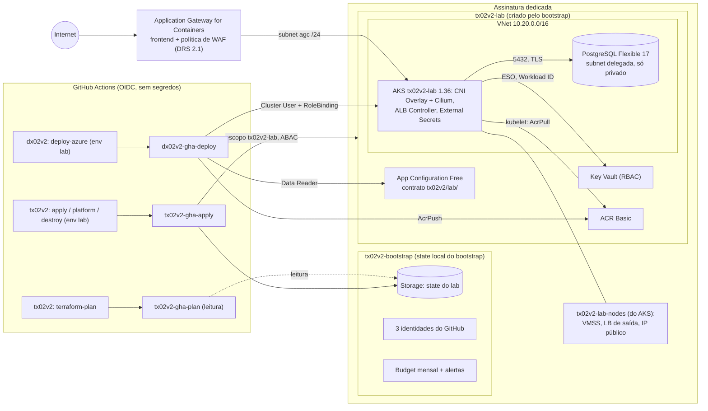
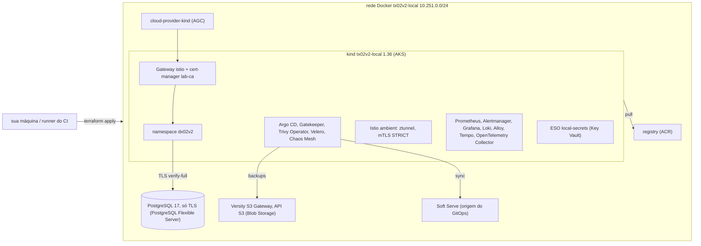

# Arquitetura do tx02v2

Visão da infraestrutura Azure do lab, as decisões por trás dela (ADRs curtos), a equivalência com o
lab AWS (`tx01v2`) e o que mudou em relação ao v1. Nada disto foi aplicado em nuvem na v2
(`não executado em nuvem (v2)`); as decisões estão cobertas pelos testes e checks citados.

## Diagrama

Camadas: `terraform/bootstrap` (uma vez, por um humano Owner da assinatura) → `terraform/envs/lab`
(módulos `network`, `aks`, `postgres`, `keyvault`, `acr`, `agc`, `appconfig`, `velero`, `role-ids`) →
`platform/` (Helm e manifests, nunca pelo Terraform) → app do `dx02v2`. O contrato entre as camadas
está em `docs/CONTRATO.md`.

## Perfil cloud full (R4)

A camada Terraform continua separada da plataforma Kubernetes. `terraform/envs/lab` provisiona Storage Account Blob, container de backup, identidade Velero e credencial federada; Helm instala 15 charts e configura os overlays Azure. `profile=core` segue como padrão do workflow; `profile=full` acrescenta Istio ambient, observabilidade, GitOps, políticas, scanning, backup e Chaos Mesh.

O Argo CD é privado via ClusterIP. Um app-of-apps lê `platform/gitops` deste repositório pela branch `main`; o chart registra `dx02v2` a partir da branch pública `gitops/azure` do repositório de aplicação. O deployer pode fazer `get`, `watch` e `patch` apenas na Application `dx02v2`, sem listar nem alterar outras Applications. Antes de remover rotas ou Gateways, `platform/uninstall.sh` para as Applications para que a reconciliação não recrie os recursos.

Velero usa o plugin Azure, Entra Workload ID e um container Blob privado com expiração de 35 dias. A role de dados é atribuída apenas no container. A Storage Account mantém o endpoint público, sem Private Endpoint, mas seu firewall nega por padrão e permite somente a subnet dos nós do AKS, com o service endpoint `Microsoft.Storage`; o CNI Overlay faz SNAT do tráfego dos pods para o IP do nó. A autenticação dos dados continua por Entra ID e não há chave compartilhada. O backup cobre recursos Kubernetes, não snapshots de disco nem PostgreSQL. O Trivy Operator não recebe credencial ACR; achados de imagens privadas podem ficar incompletos. Essa regra de rede é validada em código e testes mockados, não em uma rodada Azure.

Renders dos charts reais, contratos e teardown foram verificados localmente. Instalação, backup e restore em Azure continuam `não executado em nuvem (v2)`.

## Lab local

A mesma arquitetura emulada no Docker (`terraform/envs/local` + `platform/local`), com a plataforma
completa do v1 por cima; é o lab local do `tx01v2` com os nomes do `tx02v2` e os gêmeos Azure.
Detalhes, sondas e limites: `docs/LAB_LOCAL.md` (rodada de ponta a ponta no job `e2e` do CI).

## Decisões (ADRs curtos)

| # | Decisão | Motivo | Alternativa descartada |
|---|---|---|---|
| 1 | Microsoft Entra Workload ID para o ESO, o ALB Controller e o OpenTelemetry Collector (identidades user-assigned `tx02v2-lab-eso`, `tx02v2-lab-alb` e `tx02v2-lab-otel`, uma credencial federada por ServiceAccount) | nenhum client secret existe; o pod troca o token do ServiceAccount (issuer OIDC do AKS) por um token do Entra ID | segredo de service principal em Secret do Kubernetes; pod-managed identity (descontinuada) |
| 2 | Managed identities user-assigned com credenciais federadas do GitHub no lugar de app registrations | sem segredo, sem permissão no diretório do Entra (sem provider `azuread`); as identidades ficam no grupo do bootstrap e sobrevivem às rodadas | app registration com client secret guardado no GitHub (v1) |
| 3 | Nada de provider `kubernetes`/`helm` no Terraform | o state não depende da API do cluster; o destroy não trava em objetos Kubernetes; camadas separadas | Helm via Terraform |
| 4 | External Secrets Operator lê o Key Vault | os segredos ficam na Azure; o deployer nunca escreve Secrets | segredos criados pelo pipeline; CSI driver |
| 5 | Segredos `ephemeral` + argumentos write-only (`administrator_password_wo`, `value_wo`) | senha do banco e token de admin nunca entram no plan ou no state; `db_password_version` gira o servidor e o segredo juntos | `random_password` (fica no state) |
| 6 | Application Gateway for Containers com o ALB Controller e Gateway API | o ingress-nginx upstream foi aposentado em 2026-03-24 e o add-on de app routing com NGINX do AKS tem suporte só até novembro de 2026 (verificado em 2026-10-11); o AGC é GA, aceita Azure CNI Overlay e tem WAF | ingress-nginx + Load Balancer; Application Gateway v2 + AGIC (o maior custo do v1) |
| 7 | AGC no modo "bring your own": o Terraform cria AGC, frontend, associação à subnet, política de WAF e a SecurityPolicy; o controller só os programa | o destroy remove tudo pelo Terraform e nada criado pelo controller sobra; o `platform/uninstall.sh` ainda apaga Gateways/HTTPRoutes antes e, se alguém adicionar objetos `ApplicationLoadBalancer` (modo gerenciado), espera o AGC deles sumir | modo gerenciado pelo ALB (o controller cria o AGC no grupo de nós e a limpeza depende dele) |
| 8 | WAF ligado por padrão (`enable_waf = true`): Prevention, DRS 2.1 + Bot Manager 1.1, corpo inspecionado até 128 KB, nenhuma regra personalizada | paridade com o tx01v2; o DRS 2.1 é o único conjunto principal que o AGC aceita; com 128 KB a própria API responde 413 aos corpos grandes | modo Detection (lição 6.5 do v1); sem WAF (US$0,124/h mais barato, opcional) |
| 9 | Papéis da identidade do ALB Controller: `AppGw for Containers Configuration Manager` no grupo `tx02v2-lab` e `Network Contributor` na subnet do AGC (quickstart do modo "bring your own") | menor privilégio dentro do escopo do apply | ver o desvio abaixo |
| 10 | Azure RBAC para administradores e Kubernetes RBAC para o deployer | contas locais desligadas; admins por `Azure Kubernetes Service RBAC Cluster Admin` (`cluster_admin_principal_ids`, validado, não vazio, sem o deployer); o deployer só obtém o kubeconfig e é limitado pela RoleBinding no namespace `dx02v2` | contas locais; papéis Azure de escrita para o deployer |
| 11 | App Configuration (Free) como store do contrato | o dx02v2 lê os valores no deploy sem acessar o state; o Free não cobra e aceita 1.000 requisições por dia (cada deploy faz uma listagem) | remote state compartilhado (vaza o state inteiro) |
| 12 | O bootstrap cria o grupo `tx02v2-lab` e as identidades de CI têm papéis só nele (ou no container do state) | nada no escopo da assinatura; o apply não toca nada fora do lab | apply como Owner da assinatura (v1) |
| 13 | `Role Based Access Control Administrator` do apply com condição ABAC: só pode atribuir ou remover os 11 papéis built-in de `modules/role-ids` | o lab atribui papéis de sistema, deploy e Velero sem que o apply possa se dar Owner, User Access Administrator, Contributor ou RBAC Administrator; teste `apply_identity_is_scoped_to_the_lab` | User Access Administrator sem condição |
| 14 | Papéis do plan: `Reader` em `tx02v2-lab` e `Storage Blob Data Reader` no container do state, nada de plano de dados; o plan roda com `-refresh=false` e `-lock=false` | o plan roda em PRs do próprio repositório e o resumo dele é público: quem cria branches poderia, numa PR, ler os valores dos segredos do Key Vault pelo refresh do azurerm 5.9.0 (`GetSecret` devolve o valor; `ListClusterUserCredentials` e `GetKeyValue` completam a lista). Sem o refresh, o plan mostra a diferença contra o último state, não drift (o apply atualiza); sem plano de dados, um plan alterado não lê segredo nenhum. Antes (rodada R3.16) o plan tinha `Key Vault Secrets User`, `App Configuration Data Reader`, `AKS Cluster User` e um papel só com `ListKeys` | Contributor para o plan; `Key Vault Secrets User` com refresh |
| 15 | Plano de controle do AKS com identidade user-assigned (`tx02v2-lab-aks`) e identidade kubelet criada antes (`tx02v2-lab-kubelet`, `AcrPull` no ACR) | `Network Contributor` na subnet dos nós e `Managed Identity Operator` na identidade kubelet existem antes do cluster (sem corrida); a identidade kubelet fica no grupo do lab, dentro do escopo do apply | identidades system-assigned (papéis só depois da criação, kubelet no grupo de nós) |
| 16 | Resource providers registrados no bootstrap (`resource_providers_to_register` do provider; o root do lab usa `resource_provider_registrations = "none"`) | o v1 falhou com `MissingSubscriptionRegistration`; registrar exige o escopo da assinatura; o recurso `azurerm_resource_provider_registration` falha se já registrado e desregistra no destroy | registro manual (v1) |
| 17 | Backend `azurerm` com `container_name`, `key = "lab/terraform.tfstate"` e `use_azuread_auth = true` no código; `storage_account_name` por `-backend-config`; lock por lease de blob | chaves compartilhadas desligadas; um state por root; `resource_group_name` só seria necessário com `lookup_blob_endpoint` | access key ou SAS (v1) |
| 18 | Conta do state: StorageV2 LRS, TLS 1.2, só HTTPS, sem chaves compartilhadas, OAuth por padrão, sem blobs públicos, versionamento, soft delete de blobs e containers (7 dias), criptografia de infraestrutura e lock `CanNotDelete` | o state sobrevive às rodadas; o lock só sai com `state_protection_lock = false` no teardown | `prevent_destroy` (não dá para desligar por variável) |
| 19 | API server público restrito por `api_server_authorized_ip_ranges`; `0.0.0.0/0` exige `allow_api_server_from_anywhere = true` | runners hospedados do GitHub (plataforma, destroy, deploy do dx02v2) e laptops precisam alcançar a API; token do Entra ID e RBAC continuam obrigatórios; a escolha fica explícita | cluster privado (exigiria runner na VNet, VPN ou bastion) |
| 20 | Endpoints públicos no Key Vault, ACR, App Configuration e conta do state | runners sem IP fixo e o ESO (saída pelo IP do load balancer do AKS) precisam alcançá-los; cada requisição de dados exige token do Entra ID e papel RBAC; exceções `AZU-0012` e `AZU-0013` com validade | private endpoints (custo e runner na VNet) |
| 21 | Sem chaves gerenciadas pelo cliente (CMK) | os dados já ficam criptografados com chaves da plataforma; CMK exigiria chave no Key Vault com purge protection (que prende o nome do vault por dias) e identidades com acesso à chave | CMK em cada serviço (o tx01v2 usa uma chave KMS; outro trade-off) |
| 22 | Purga do Key Vault no destroy opcional (`purge_key_vault_on_destroy = false`) | a purga exige permissão no escopo da assinatura, que as identidades de CI não têm; ver "A armadilha do soft delete" | purga sempre (falharia no CI) |
| 23 | AKS no tier Free | sem SLA, aceitável num lab com menos de 10 nós; o Standard custa US$0,10/h | tier Standard |
| 24 | Azure CNI Overlay com dataplane e policy Cilium | aplica NetworkPolicy (as do dx02v2 importam); IPs de pod no overlay (`10.244.0.0/16`) não consomem a VNet; o AGC aceita Overlay com subnet /24 | kubenet (aposentado); Azure CNI plano (um IP da VNet por pod) |
| 25 | Um system pool `Standard_D2als_v6` (Azure Linux), autoscaler 1–3, o app roda nele | um pool só é o mais barato; o AKS não suporta a série B em system pools (verificado em 2026-10-11, `docs/CUSTOS.md`) | pool de usuário separado (mais nós) |
| 26 | PostgreSQL só com acesso privado (subnet delegada + zona DNS privada) e NSG que libera 5432 só da subnet dos nós | sem regra de firewall nem endpoint público; o Azure CNI Overlay sai pelo IP do nó | acesso público com regras de firewall (v1) |
| 27 | O usuário admin do PostgreSQL é o usuário do app; dados do lab são descartáveis (sem `prevent_destroy`) | o lab não roda SQL de provisionamento; toda rodada termina com destroy | usuário de app separado (exigiria provider PostgreSQL ou job) |
| 28 | Sem flow logs | os NSG flow logs estão sendo aposentados pela Azure; VNet flow logs exigem Network Watcher no `NetworkWatcherRG` (fora do escopo do apply) e uma conta de storage | VNet flow logs |
| 29 | Logs do plano de controle opcionais (`enable_control_plane_logs`): `kube-audit-admin` e `guard` num workspace PerGB2018 com teto de 0,5 GB/dia e 30 dias | ingestão cobrada por GB; desligado por padrão | sempre ligado |
| 30 | Sufixo determinístico `substr(sha1(subscription_id), 0, 8)` nos nomes globais | nomes previsíveis para o dx02v2 e o `platform/install.sh` (endpoint da App Configuration derivável); nada aleatório no state | sufixo aleatório |
| 31 | Lab local com Terraform + provider Docker e kind por CLI (`terraform_data` + `local-exec`) | o mesmo fluxo apply/destroy da nuvem, sem conta; o provider `tehcyx/kind` embute uma versão antiga do kind; o state local guarda credenciais descartáveis desta máquina (`random_password` só em `terraform/envs/local`) | emuladores da Azure (o Azurite emula só o storage; AKS, AGC e Key Vault não têm emulador local oficial); minikube |
| 32 | Istio ambient no lab local | mTLS e autorização por identidade sem sidecar; roda no kind | sidecar (mais memória por pod); Linkerd |
| 33 | GitOps local com Argo CD lendo um servidor Git do lab | um único dono do namespace do app; o push usa a chave do state, a leitura é anônima; Argo CD fica ClusterIP | Flux no lab local; o perfil cloud full lê repositórios públicos GitHub e sincroniza `gitops/azure` sem credenciais |
| 34 | Gatekeeper com políticas próprias testadas no `gator` | as regras do v1, em `deny`, com casos que provam aceitação e recusa; sem o add-on Azure Policy, que no v1 brigava com o Gatekeeper | gatekeeper-library inteira (mais regras do que o lab explica); Kyverno |
| 35 | Alertmanager → `alert-sink` dentro do cluster; receiver do Slack com o webhook num Secret opcional | entrega de alerta provada sem credencial externa; sem webhook, a mensagem no formato do Slack vai para o sink e a sonda confere o conteúdo | webhook do Slack nos values versionados (v1) |
| 36 | Velero no emulador de objetos (API S3), backup por recursos, sem snapshots | ensaio local de restore em minutos; plugin Azure e Blob privado com Workload ID no perfil cloud full, expiração de 35 dias e role limitada ao container | `pg_dump` sozinho; snapshots CSI; nenhum backup PostgreSQL implícito |
| 37 | Perfis `core`/`observability`/`operations`/`full`; rede `10.251.0.0/24` e registry em `localhost:5002` | máquinas com pouca memória validam uma camada por vez; o CI roda `full`; rede e porta diferentes das do `tx01v2` (`10.250.0.0/24`, `5001`) evitam colisão entre os labs | um único perfil; os mesmos endereços em todos os pares |
| 38 | Traces: o OpenTelemetry Collector como único destino OTLP; Tempo no lab local, Application Insights na nuvem (ingestão só com token do Entra ID: autenticação local desligada, extensão `azure_auth` com o Workload ID de `tx02v2-lab-otel` e `Monitoring Metrics Publisher` só nesse recurso) | o app e os Gateways falam só OTLP; trocar o backend não muda o app; a connection string vira endereço, não segredo; Tempo monolítico cabe no kind | connection string com autenticação local (a chave de instrumentação basta para gravar); SDK do Application Insights no app (prende o app à Azure); AAD Auth Proxy em sidecar |

| 39 | Perfil cloud `core` e `full` | full instala 15 charts com pacotes e imagens pinados; requests renderizados: 795 mCPU e 3104 MiB em dois nós; sizing comparado com `docs/CUSTOS.md` | core continua o padrão de menor custo; os checks não aplicam recursos Azure |
| 40 | Observabilidade do perfil `full` continua dentro do cluster | mantém as mesmas versões, imagens e sondas do lab local; o custo e os limites da alternativa gerenciada estão em `docs/CUSTOS.md` | Azure Monitor Managed Prometheus + Azure Managed Grafana + Log Analytics |
| 41 | Istio ambient usa os charts upstream sobre Azure CNI Overlay com dataplane Cilium | o Istio CNI upstream declara compatibilidade com plugins CNI conformes; o AKS mantém o Azure CNI como plugin de rede | malha sidecar ou add-on gerenciado; o suporte ao conjunto upstream não foi validado pela Microsoft nem em nuvem |
| 42 | Blob do Velero usa firewall com negação padrão e libera apenas a subnet dos nós AKS | service endpoint `Microsoft.Storage`; os pods Overlay saem com SNAT do IP do nó; autenticação Entra ID continua obrigatória; AZU-0010 tem exceção temporária porque nenhum serviço Azure precisa acessar a conta | endpoint público sem regra de rede; bypass genérico de AzureServices |

### R4.2 — Decisão de observabilidade (verificada em 2026-10-16)

O perfil `full` mantém kube-prometheus-stack, Loki + Alloy e Tempo no cluster. Isso preserva a paridade
com o lab local e permite que as sondas exercitem ingestão Prometheus, regras e alertas, dashboards,
logs, traces e a carga dos próprios charts. Prometheus, Loki e Tempo usam `emptyDir`: seus dados não
duram depois do destroy. O Collector continua enviando os traces do app ao Application Insights do
core e também ao Tempo.

A alternativa é Azure Monitor Managed Prometheus + Azure Managed Grafana + Log Analytics. Ela
exercitaria a coleta gerenciada do AKS, DCR/AMA, consultas PromQL, a integração com Entra ID e retenção
do serviço; não provaria a operação dos charts locais de Prometheus, Loki e Tempo. O Managed Prometheus
cobra por amostras ingeridas e processadas em consultas; a documentação consultada informa retenção
de 18 meses. Grafana Standard X1 usa duas Standard Units e também cobra usuários ativos. Como não
temos volume medido de amostras nem de logs, `docs/CUSTOS.md` apresenta a fórmula e o custo-base de
uma rodada, sem inventar um total gerenciado.

Fontes consultadas em 2026-10-16: [Azure Monitor Managed Prometheus](https://learn.microsoft.com/azure/azure-monitor/metrics/prometheus-metrics-overview), [preços do Azure Monitor](https://azure.microsoft.com/pricing/details/monitor/), [opções de Grafana no Azure Monitor](https://learn.microsoft.com/azure/azure-monitor/visualize/visualize-grafana-overview), [Azure Managed Grafana](https://learn.microsoft.com/azure/managed-grafana/overview) e [preços do Azure Managed Grafana](https://azure.microsoft.com/pricing/details/managed-grafana/). Os preços são referências da Retail Prices API para `eastus2`, não faturas observadas; confira as tarifas da assinatura antes de uma rodada.

### R4.3 — Istio ambient no AKS (verificado em 2026-10-16)

O cluster mantém Azure CNI Overlay e dataplane Cilium; os charts upstream instalam `istio-cni` em
encadeamento e ztunnel, sem substituir o plugin de rede do AKS. A documentação do Istio diz que seu
CNI segue a especificação e deve ser compatível com plugins conformes. A documentação da Microsoft
descreve Azure CNI Overlay e sua combinação com Cilium, e diz que o Istio CNI do add-on é separado do
Azure CNI. Isso sustenta a escolha técnica, mas não é uma declaração da Microsoft de suporte aos
charts upstream de Istio ambient. A instalação e o tráfego continuam `não executado em nuvem (v2)`.

O tráfego ambient usa HBONE em TCP 15008. As NetworkPolicies do app no `dx02v2` devem permitir essa
porta entre os pods selecionados e as sondas do kubelet em `169.254.7.127/32`, conforme o contrato e
o PR consumidor coordenado. Fontes consultadas em 2026-10-16: [Istio CNI](https://istio.io/latest/docs/setup/additional-setup/cni/), [Istio ambient e NetworkPolicy](https://istio.io/latest/docs/ambient/usage/networkpolicy/), [Azure CNI Overlay no AKS](https://learn.microsoft.com/azure/aks/azure-cni-overlay), [dataplane Cilium no AKS](https://learn.microsoft.com/azure/aks/azure-cni-powered-by-cilium) e [Istio CNI do add-on AKS](https://learn.microsoft.com/azure/aks/istio-cni).

### R4.5 — Rede do Blob do Velero (verificado em 2026-10-16)

O endpoint do Storage Account continua público porque o lab não cria Private Endpoint. O firewall
tem `default_action = Deny` e permite somente a subnet dos nós do AKS, que habilita o service endpoint
`Microsoft.Storage`; os pods do Azure CNI Overlay usam SNAT do nó para destinos fora do CIDR de pods.
O container continua privado, a role de dados fica no container, e cada chamada ainda precisa de um
token Entra ID válido. O Trivy AZU-0010 recomenda permitir o bypass geral `AzureServices`; nenhum
serviço Azure consome esta conta, então o bypass fica desligado e a exceção temporária, com validade
até 2027-04-16, está em `.trivyignore.yaml`. A documentação da Microsoft explica que o bypass é uma
exceção de rede para serviços Azure fora da fronteira que precisem acessar a conta, usando
autenticação forte. Fontes: [regras de rede do Azure Storage](https://learn.microsoft.com/en-us/azure/storage/common/storage-network-security), [trusted Azure services](https://learn.microsoft.com/en-us/azure/storage/common/storage-network-security-trusted-azure-services), [service endpoint para Storage](https://learn.microsoft.com/en-us/azure/storage/common/storage-network-security-virtual-networks) e [SNAT do Azure CNI Overlay](https://learn.microsoft.com/en-us/azure/aks/concepts-network-azure-cni-overlay). Esta configuração foi validada por Terraform e testes mockados, sem acesso ou aplicação em nuvem.

### Desvio documentado: papéis do ALB Controller

O quickstart do ALB Controller com Helm também atribui `Reader` no grupo de nós do AKS
(`tx02v2-lab-nodes`). O lab não faz isso: o apply só atribui papéis dentro de `tx02v2-lab`, e o
exemplo Terraform oficial do modo "bring your own" funciona sem esse papel (documentação conferida em
2026-10-11; não testado em nuvem). Se o controller registrar erro de autorização no grupo de nós,
atribua o papel à mão como Owner (`az role assignment create --assignee <client ID de tx02v2-lab-alb>
--role Reader --scope /subscriptions/<SUBSCRIPTION_ID>/resourceGroups/tx02v2-lab-nodes`) e registre no
`cloud_run_report`. O nome da credencial federada é `azure-alb-identity`, o do quickstart oficial.

### O dono da assinatura não lê dados

Owner e Contributor não têm *data actions*. Com chaves compartilhadas e autenticação local
desligadas, o plano de dados exige papéis próprios:

- state: `Storage Blob Data Contributor` no container `tfstate` (o bootstrap dá esse papel a quem o
  aplica; sem ele, `terraform init` do lab falha com 403);
- Key Vault: `Key Vault Secrets Officer` para gravar os segredos (o apply tem) e `Key Vault Secrets
  User` para lê-los (o plan e o ESO têm);
- App Configuration: `App Configuration Data Owner` para gravar as chaves (o apply tem) e `App
  Configuration Data Reader` para lê-las (o plan e o deploy têm);
- AKS com Azure RBAC: `Azure Kubernetes Service RBAC Cluster Admin` (os `cluster_admin_principal_ids`).

Quem aplicar o lab localmente precisa desses papéis para si (`docs/RUNBOOK.md`, seções 4 e 5).

### A armadilha do soft delete

O soft delete do Key Vault não pode ser desligado: depois do destroy, o vault
`tx02v2-lab-<suffix>` fica apagado-mas-retido por 7 dias e **o nome continua reservado**. Como o
sufixo é determinístico, a próxima rodada na mesma assinatura tenta o mesmo nome e falha, porque o
provider está configurado para nunca recuperar um vault antigo (`recover_soft_deleted_key_vaults =
false`: cada rodada começa com um vault vazio). Saídas: esperar os 7 dias, purgar como Owner
(`az keyvault purge --name tx02v2-lab-<suffix>`) ou destruir localmente como Owner com
`purge_key_vault_on_destroy = true`. A purga exige
`Microsoft.KeyVault/locations/deletedVaults/purge/action` no escopo da assinatura; as identidades de
CI não têm, por isso o padrão é `false`. A purge protection fica desligada (com ela, nem o Owner
conseguiria purgar). Os segredos dentro do vault são purgados no destroy
(`purge_soft_deleted_secrets_on_destroy`, ação de dados do Secrets Officer). A App Configuration no
tier Free não tem soft delete; o `scripts/leftovers.sh` lista vaults, stores e workspaces apagados
que ainda prendem nomes.

## AWS (tx01v2) ↔ Azure (tx02v2)

| Tema | tx01v2 (AWS) | tx02v2 (Azure) |
|---|---|---|
| Bootstrap | bucket S3 (lock nativo), provider OIDC, 3 papéis, budget | conta de storage (lease de blob), registro de providers, grupo do lab, 3 managed identities federadas, budget |
| Identidade do CI | papéis IAM com `sub` exato | managed identities com um sujeito exato por credencial federada |
| Limite do apply | papel quase administrador da conta; permission boundary `planejado` | Contributor + papéis de dados só em `tx02v2-lab`; atribuição de papéis limitada por ABAC |
| Cluster | EKS 1.36, access entries, Pod Identity, add-ons gerenciados | AKS 1.36 Free, Entra ID + Azure RBAC, Workload ID, contas locais desligadas |
| Nós | AL2023 SPOT t3.medium/t3a.medium | Azure Linux, `Standard_D2als_v6` pay-as-you-go (system pool não aceita Spot) |
| Rede | VPC com subnets públicas/privadas, 1 NAT gateway | VNet com subnets delegadas, CNI Overlay + Cilium, saída pelo Load Balancer do AKS |
| Entrada | ALB do Load Balancer Controller (Ingress) + web ACL do WAF | Application Gateway for Containers (Gateway API) + política de WAF DRS 2.1 |
| Banco | RDS PostgreSQL 17, `rds.force_ssl` | PostgreSQL Flexible Server 17 privado, `require_secure_transport = on` |
| Segredos | Secrets Manager + KMS, ESO por Pod Identity | Key Vault (RBAC), ESO por Workload ID |
| Registry | ECR com tags imutáveis | ACR Basic (sem imutabilidade: o deploy recusa sobrescrever tags) |
| Contrato | SSM Parameter Store `/tx01v2/lab/*` | App Configuration `tx02v2/lab/*` |
| Tags | `default_tags` do provider | `local.tags` em cada recurso (check `policy-tags`) |
| Criptografia | chave KMS do lab | chaves da plataforma (sem CMK) |
| Maior custo | plano de controle do EKS + NAT | AGC com WAF |

## v1 → v2

| Problema no v1 (tx02) | Decisão no v2 | Evidência |
|---|---|---|
| OIDC e pins de provider aplicados num root órfão que dividia a chave de state do prd (um apply ali planejaria destruir o prd) | um único root (`terraform/envs/lab`) com chave fixa `lab/terraform.tfstate`; bootstrap separado com state local | `terraform/envs/lab/versions.tf`, `terraform/bootstrap/versions.tf` |
| prd ainda com `use_cli = true`/`use_oidc = false` | nenhuma credencial no código; OIDC pelas variáveis `ARM_*` | `policy-terraform` (proíbe `use_cli`, `use_oidc`, `client_secret` no provider e no backend) |
| Workflows com `vars.*` vazias, `permissions` de job derrubando `id-token`, sem passo de `azure/login` | o primeiro passo (`Check ...`) valida as variáveis; `id-token: write` só em jobs de nuvem com `environment: lab` (e no plan, atrás da guarda de variável e de mesmo repositório); `azure/login` com client, tenant e assinatura de `vars.*` | `policy-workflows` (exige o passo, o environment e o login por `vars.*`) |
| Terraform 1.6.0 fixado (init falha: chave da HashiCorp expirada) | `required_version >= 1.11.0, < 2.0.0`; harness com 1.16.5 por SHA256 | `tool-versions`, `version-consistency` |
| tfsec com `soft_fail`, Checkov soft-fail, ZAP com `fail_action: false` | trivy HIGH/CRITICAL bloqueante; nada de `continue-on-error` ou `\|\| true` | `trivy-config`, `trivy-config-tfvars`, `policy-workflows` |
| Segredos de service principal de longa duração como secrets do repositório | managed identities com credenciais federadas; nenhum segredo de nuvem no GitHub | `identities.tftest.hcl`; `policy-workflows` (proíbe `client-secret`, `creds`, `ARM_CLIENT_SECRET`) |
| Argo CD e Grafana expostos em LoadBalancers públicos no v1 | O perfil core não instala interfaces web; o perfil cloud full usa Argo CD e Grafana como Services ClusterIP, sem senha padrão, com UI acessível via `kubectl port-forward` | `platform/full/charts.txt`, `platform/local/values/argo-cd.yaml`, checks de Helm |
| API do AKS pública sem ranges autorizados, contas locais ligadas, sem RBAC do Entra | ranges obrigatórios (`0.0.0.0/0` com opt-in), `local_account_disabled = true`, Azure RBAC | `aks.tftest.hcl`, `validations.tftest.hcl`, `policy-terraform` |
| Chart vulnerável do ingress-nginx | AGC com o ALB Controller fixado: SHA256 do chart e digests das imagens conferidos | `helm-template`, `platform/install.sh` |
| Destroy que apagava backups antes do gate de aprovação | o job só começa depois da aprovação do environment `lab`, e o primeiro passo recusa qualquer confirmação diferente de `destroy tx02v2-lab`; nada é apagado antes | `terraform-destroy.yml`, `policy-workflows` |
| Senha de admin do SQL em cloud-init, outputs e state | `ephemeral` + write-only; outputs só não sensíveis | `postgres_password_never_in_plan_or_state`, `key_vault_and_secrets` |
| Modo VM quebrado (senha desligada sem chave SSH) | sem modo VM: só AKS | `terraform/` |
| Deriva de copia-e-cola entre prd e stg e três conjuntos de valores nos workflows | um ambiente (`lab`); todo input em `variables.tf`, os não booleanos com validação; os workflows passam os inputs como `TF_VAR_*` (de `vars.*` e do dono do repositório), sem editar arquivos | `validations.tftest.hcl` (31 casos), `policy-workflows` (proíbe `sed` em `.tf`) |
| Gatekeeper brigando com o add-on Azure Policy | sem o add-on Azure Policy | `policy-terraform`, `aks.tftest.hcl` |
| README afirmando NAT, Key Vault, TLS em tudo e aprovações que não existiam | matriz de status com rótulos exatos e evidência | `repo-structure`; `README.md` |
| `.gitignore` corrompido em UTF-16 | `.gitattributes` com `eol=lf`; o harness recusa CRLF | `repo-structure` |
| SHAs de actions que não existiam | SHAs resolvidos com `gh api` (tags anotadas desreferenciadas); SHA de 40 caracteres + `# vX.Y.Z`; um SHA por action | `policy-workflows`, `version-consistency`, `docs/SUSTENTACAO.md` |
| 114 de 223 commits eram `fix:` | o harness local roda exatamente o que o CI roda, antes do push | `make verify`, `docs/HARNESS.md` |
